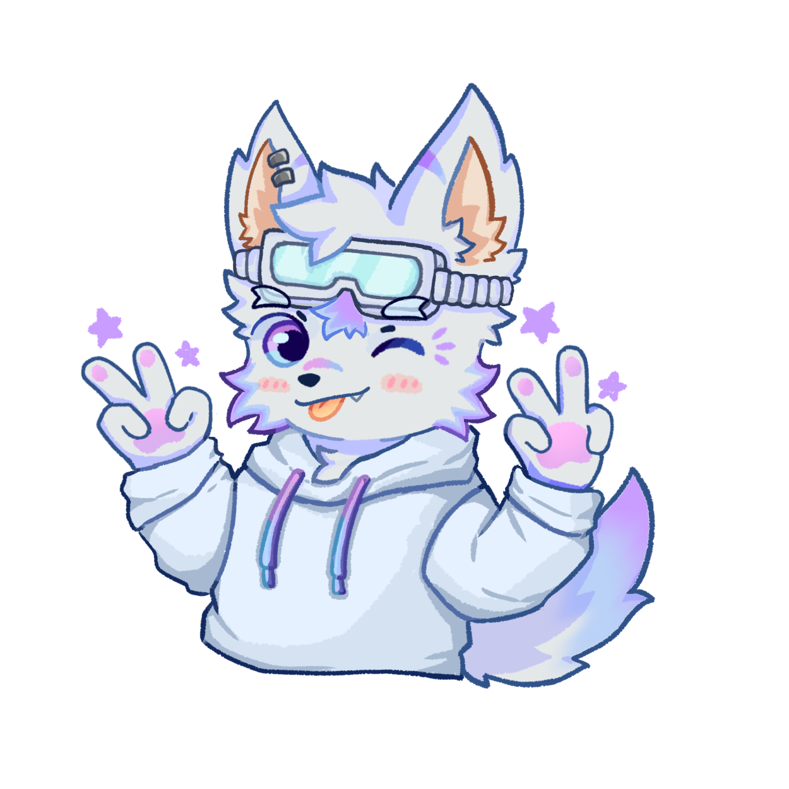
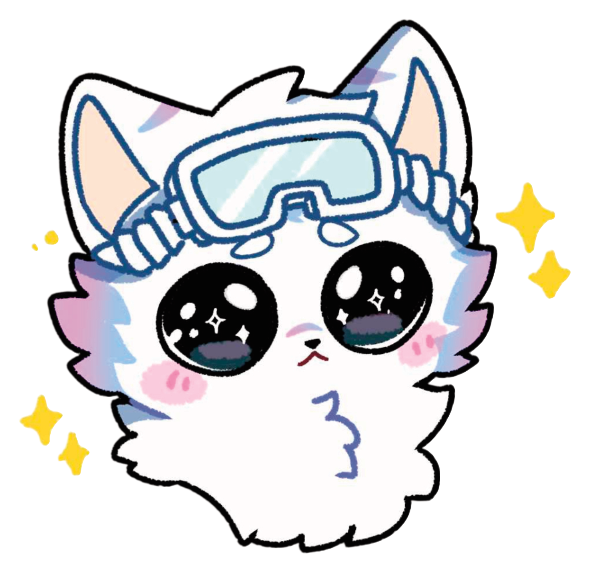
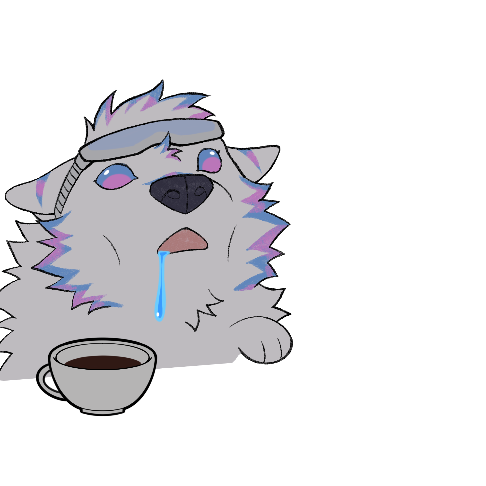
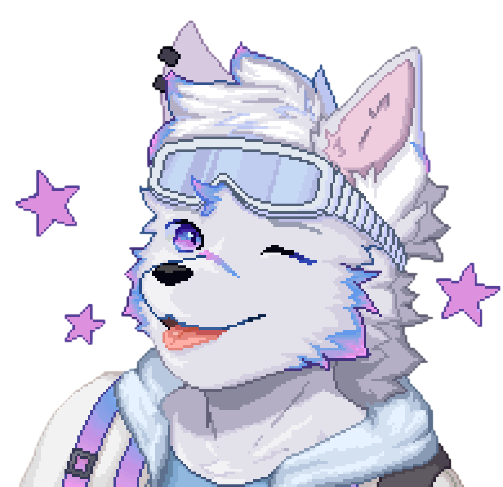

<!--
  DESIGN TOKENS (kept in one place so you can retune fast)
  Wave gradient   : #006CFF -> #643BFF -> #DE00FF              (header + footer waves)
  Sunset gradient : #FF8A5B -> #F6A96B -> #E8739E -> #7B68EE   (GradientRibbon.png dividers)
  Icon ink        : #E0692F ember, #E2557F rose, #7B68EE violet (3:1+ on light AND dark GitHub)
  Text-on-light   : #C2417A rose, #5B47D6 violet               (4.5:1+ on white)
  Text-on-dark    : #E8739E rose, #9D8FFF violet               (4.5:1+ on #0d1117)
  Card ink        : #282A36

  LAYOUT RULE: GitHub strips CSS, so alignment comes from fixed cell widths.
  Every section is 700px wide:  split cards = 480 text + 220 sticker,  grids = 4 x 175.
  Every sticker uses the same height (180) so they read as one set, whatever their aspect ratio.
  Each sticker appears ONCE on the page, so every section has its own mood.
-->

<!-- ===================== HERO ===================== -->

<!-- Rotating roles -->
<a href="https://github.com/ArciusWolf">
  <picture>
    <source media="(prefers-color-scheme: dark)" srcset="https://readme-typing-svg.demolab.com?font=Space+Grotesk&weight=600&size=22&letterSpacing=1px&duration=3000&pause=1200&color=9D8FFF&center=true&vCenter=true&width=720&height=40&lines=Unity+Game+Developer;Gameplay+%26+Simulation+Systems;Currently+building+Furever">
    
  </picture>
</a>

  

<!-- Social badges. Uncomment each one once you have the real link: a dead link hurts more than a missing badge.

-->

 

<!-- ===================== ABOUT  (text 480 | sticker 220, both vertically centered) ===================== -->
<table align="center">
  <tr>
    <td width="480" valign="middle">
      <h3>Hi, I'm Cyrus</h3>
      Game developer from <b>Vietnam</b>. I mostly work in <b>Unity</b> and <b>C#</b>: gameplay systems, simulation mechanics, and editor tools that make my own workflow less painful.  
      Right now I'm building <b>Furever</b>, a cozy life sim in <b>Unity 6</b>.
    </td>
    <td width="220" align="center" valign="middle">
      
    </td>
  </tr>
</table>

 

<!-- ===================== TECH STACK ===================== -->
<h2 align="center">&nbsp; Tech Stack</h2>

  

  

<!-- ===================== FUREVER  (text 480 | sticker 220, then 4 x 175 grid) ===================== -->
<h2 align="center">&nbsp; Currently Building: Furever</h2>

<table align="center">
  <tr>
    <td width="480" valign="middle">
      A cozy life sim I'm building solo in <b>Unity 6</b>.  
      
       
      
      
    </td>
    <td width="220" align="center" valign="middle">
      
    </td>
  </tr>
</table>

<table align="center">
  <tr>
    <td align="center" valign="top" width="175"> <b>Interaction System</b></td>
    <td align="center" valign="top" width="175"> <b>Player States</b></td>
    <td align="center" valign="top" width="175"> <b>Build Mode</b></td>
    <td align="center" valign="top" width="175"> <b>Inventory &nbsp;</b></td>
  </tr>
  <tr>
    <td align="center" valign="top" width="175"> <b>Day / Night Cycle</b></td>
    <td align="center" valign="top" width="175"> <b>Fishing &nbsp;</b></td>
    <td align="center" valign="top" width="175"> <b>Player Needs</b></td>
    <td align="center" valign="top" width="175"> <b>Editor Tools</b></td>
  </tr>
</table>

<!-- TODO: add a gameplay GIF or screenshot here. It is the single biggest upgrade you can make.

  

-->

  

<!-- ===================== DEV DASHBOARD ===================== -->
<h2 align="center">&nbsp; Dev Dashboard</h2>

  

<!-- Pac-Man: generated daily by .github/workflows/pacman.yml into the pacman-output branch -->

  <picture>
    <source media="(prefers-color-scheme: dark)" srcset="https://raw.githubusercontent.com/ArciusWolf/ArciusWolf/pacman-output/pacman-contribution-graph-dark.svg">
    
  </picture>

 

<!-- ===================== RECENTLY PLAYED  (music card 480 | sticker 220) ===================== -->
<h2 align="center">&nbsp; Recently Played</h2>

<table align="center">
  <tr>
    <td width="480" align="center" valign="middle">
      

        
      

      fueled by coffee and music
    </td>
    <td width="220" align="center" valign="middle">
      
    </td>
  </tr>
</table>

<!-- ===================== FOOTER ===================== -->

  

  

